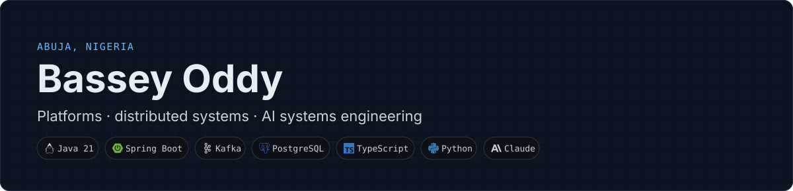

Software architect and engineer in Lagos, Nigeria. I design and build platforms end to end: multi-tenant
data, event-driven services, and AI integrated with the guarantees around it that real institutions need.

## What I'm building

<table>
<tr>
<td width="72" valign="top"></td>
<td><b>A revenue management platform for Nigerian state governments.</b> Multi-tenant tax and revenue administration under the 2025 tax reform: one taxpayer identity across every tax, maker-checker approval on every workflow, a single ledger that changes only through approved allocation, dated statutory rates, an immutable audit trail, and five Nigerian languages. Deployable to a shared cloud or on-premises in a state office from the same images.</td>
</tr>
<tr>
<td width="72" valign="top"></td>
<td><b>An AI-assisted learning platform for schools and universities.</b> Graphs, 3D solids and a working model of the human body that students manipulate, from anatomy built from real CT scans to a heart and lungs driven by a physiology engine. A lecturer's own notes are read by a multi-stage AI pipeline and turned into a lesson; a maths engine, not the AI, decides what is correct. Built for classroom boards, PCs and tablets.</td>
</tr>
</table>

## AI systems engineering

Designed and built in production systems:

- **Agents that act on live systems.** Models propose actions on an interactive 3D or maths scene through a typed tool catalogue; every action is validated and checked by a deterministic engine before it runs, with undo.
- **Document understanding pipelines.** Multi-stage reading of long PDFs: a fast outline, a deep pass per topic on the strongest model, then an independent second model reviewing each claim; results anchored to the page and line they came from.
- **Grounding and knowledge.** Answers grounded on a generated knowledge base of what each tool and 3D model can show; the model names what is needed, code decides whether it is met, so ratings are reproducible.
- **Structured outputs.** Every response bound to a schema or a typed record and checked before use; malformed or unverifiable output never reaches a user.
- **Model routing and fallback.** A router choosing per job among models that passed that job's test set, by quality tier, cost and what data each provider may see; streaming over gRPC with fallback before the first token.
- **An AI gateway for regulated data.** Names and contact details removed and identities replaced by keyed pseudonyms before any call; monthly budgets per organisation and per learner; every call costed and logged.
- **Reproducible and cost-aware.** Readings cached by content hash, prompt and model version, so the same material gives the same result at no new cost; untrusted content fenced off from instructions.
- **Evaluation.** Test sets per job, measured agreement between models, and human-in-the-loop adjudication with accuracy, confusion and error measures.

 Claude (Haiku, Sonnet, Opus) &nbsp;&nbsp;  Spring AI &nbsp;&nbsp;  Python &nbsp;&nbsp; gRPC and protobuf &nbsp;&nbsp; JSON Schema

## Areas of depth

**Platform architecture.** Multi-tenant SaaS: shared and dedicated databases, schema per tenant, row-level security, tenant routing, moving a tenant without loss. Domain-driven design for regulated work: maker-checker, ledgers, idempotency, audit. Event-driven systems and contracts shared across Java, TypeScript and Python. 
 Kafka &nbsp;&nbsp;  RabbitMQ &nbsp;&nbsp;  PostgreSQL &nbsp;&nbsp; gRPC &nbsp;&nbsp; CQRS and event sourcing

**Backend and data.** Services in Java and Kotlin, plain JDBC where it matters; search, analytics and ingestion pipelines. 
 Java 21 &nbsp;&nbsp;  Kotlin &nbsp;&nbsp;  Spring Boot &nbsp;&nbsp;  MySQL &nbsp;&nbsp;  MongoDB &nbsp;&nbsp;  Redis &nbsp;&nbsp;  Elasticsearch &nbsp;&nbsp;  ClickHouse &nbsp;&nbsp;  Apache NiFi

**Interactive and 3D web.** Anatomy built from CT scans, viewed and taken apart in the browser and in a headset; computer algebra and numeric engines running client-side. 
 TypeScript &nbsp;&nbsp;  React &nbsp;&nbsp;  Next.js &nbsp;&nbsp;  Three.js &nbsp;&nbsp; WebXR

**Delivery and operations.** Containers, gateways and metrics; CI on every change; systems sized to run on modest hardware or a state office server. 
 Docker &nbsp;&nbsp;  Kubernetes &nbsp;&nbsp;  Envoy &nbsp;&nbsp;  Prometheus &nbsp;&nbsp;  Grafana &nbsp;&nbsp;  GitHub Actions &nbsp;&nbsp;  Jenkins &nbsp;&nbsp;  CircleCI &nbsp;&nbsp;  AWS &nbsp;&nbsp; Azure

## Selected public work

| Project | What it shows |
|---|---|
| [ai-code-reviewer](https://github.com/oddy-bassey/ai-code-reviewer) | My Naija Java talk, *Java Meets Generative AI*: an AI code reviewer whose answers arrive as Java `record`s, not text, and what that makes possible |
| [llm-eval-portal](https://github.com/oddy-bassey/llm-eval-portal) | Evaluating LLM outputs with people in the loop: run a dataset against several models, adjudicate, measure accuracy, confusion and error |
| [ZuBank](https://github.com/oddy-bassey/ZuBank-ws) | A bank as microservices: CQRS and event sourcing, an API gateway, config and discovery servers, CI per service |
| [nifi-utils](https://github.com/oddy-bassey/nifi-utils) · [CustomProcessor](https://github.com/oddy-bassey/CustomProcessor) | Custom Apache NiFi processors for data ingestion |

## Speaking

**Java Meets Generative AI: Building a Type-Safe AI Code Reviewer with Spring AI** 
Lightning talk, Naija Java User Group, 25 August 2026, supported by JetBrains · [code and slides](https://github.com/oddy-bassey/ai-code-reviewer)

## Contact

[LinkedIn](https://www.linkedin.com/in/bassey-oddy-3287ba352) · [X](https://x.com/oddy_bassey)
